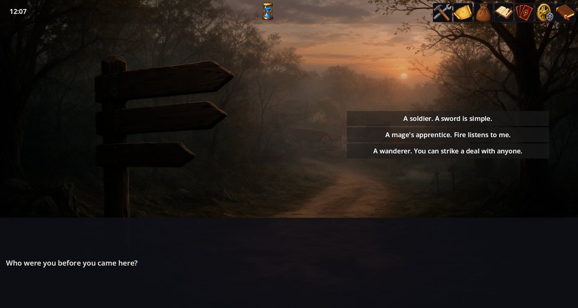
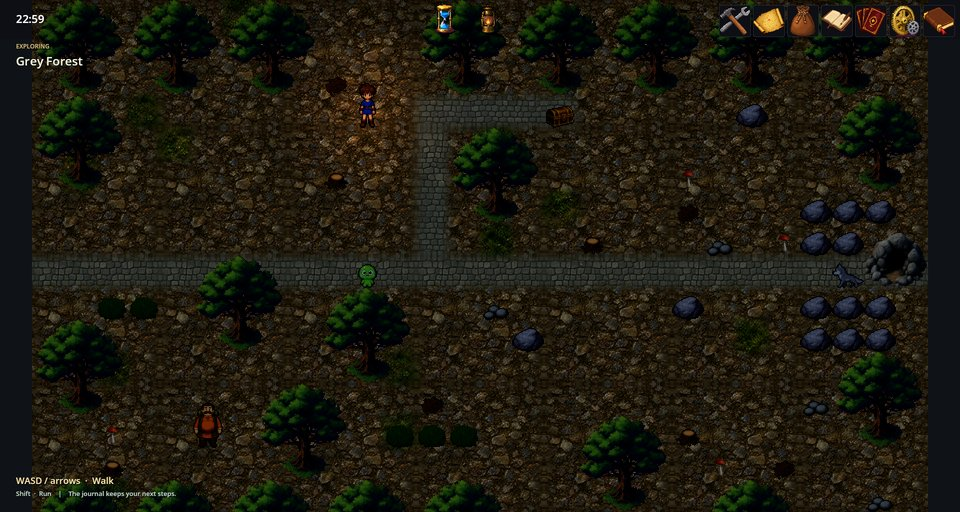
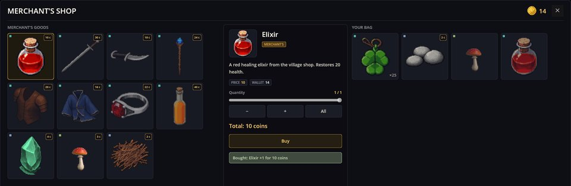

# RPG Plus — a woodland RPG built from mods

RPG Plus is a complete small RPG: a visual-novel prologue where you choose who your hero was, then a tile-map village and forest, a mystery about the forest's lost light, side quests, a workbench, a merchant, a desert to the west and turn-based battles. The game is made of data files and scenarios only; its rules — stats, gear, checks, battles, crafting — come from separate mods that any other game can use too.

Start it from **Play → RPG Plus → New game**.



## The story and how to play

1. **The crossroads.** Choose your past: a **soldier** (warrior), a **mage's apprentice** (mage) or a **wanderer** (rogue). The choice sets your stats and your starting gear. You start with 25 coins.
2. **The village by the Grey Forest.** Walk with WASD or the arrows, run with Shift, use E or F to talk and interact. The **journal** always lists your concrete next step.
3. **The elder** asks about the missing light or sends you straight after the wolf at the eastern cave.
4. **The forest.** Gather brushwood and mushrooms; slimes drop living resin and coins. The wolf always drops an amber heart and enough fur for a mantle.
5. **The well workbench.** Make a woodland salve (mushroom + resin), a warden mantle (2 fur + 2 resin) or the ward lantern (amber + 2 resin + 2 branches). Put the mantle on from the bag: it changes your real battle numbers.
6. **The herbalist** by the western fence needs salve; helping her leads to a missing courier in the southern forest.
7. **The shrine.** Take the lantern through the cave behind the wolf to the ruined shrine. Return the light to the forest, or strike a pact for the village. Both endings finish the adventure, and the elder's last words follow your choice.

Other people in the village: the **trainer** takes you to the training yard (experience once, and a strength check to lift a log), and the **seer** reads your luck. The hearth by the well restores health and mana. Rewards cannot be collected twice.







### The desert

From the village, follow the main road west off the edge of the map to reach **the Dry March**: sand, an adobe house, a caravan shelter, a ruined tower, palms and cacti. Five scorpions and beetles wait to be fought, and supply barrels hold small one-time rewards. The east edge leads back to the village.


## Your hero

Open the **character sheet** from the toolbar to see your class, level and experience, attributes (Strength, Agility, Intelligence, Vitality, Charisma, Luck), combat values and gear in the weapon, body and accessory slots. Equip things from the bag.


Battles use the command-style (FF) battle with damage computed by formulas. Some dialog options test an attribute against a d20 roll, such as the trainer's **[Strength 12]**.


## How the game is assembled

RPG Plus is the collection **RPG Plus**. Its blocks:

```text
Story and world    rpg_plus_game
Assets and rules      village_pack (art), classic_rpg_pack (stats, classes, gear)
Stats and checks      stats_base, stat_checks
Tile world            rpg
Items, gear, trade    items_base, equipment, trading, crafting
2D engine             shell2d_base, dialog_base, characters_base, audio_base
Battle                turn_battle_base, ff_battle, battle_formulas
Card battle           card_battle (optional)
Interface             ui_base, menu_base
Tile map editor       rpg_editor (optional)
Data editors          schema_tools, items_editor, characters_editor (optional)
Tile renderer         tile_topdown_base, tile_isometric_base
```

Settings of the collection: `battle.core` is `ff_battle`, checks roll `d20`, the hero's map sprite is `village/hero`, maps are drawn top-down. Change them in **Mods & Collections → Collections → RPG Plus → Edit scheme**.

## For authors: change it without code

```filestree
rpg_plus_game/
├── maps/                       village, house, forest, shrine, desert
├── scenes/                     tile maps, crossroads, training yard
├── placements/<map>/           NPCs, doors, pickups, barrels
├── scenarios/rpg_plus/         village intro, map interactions, prologue, training, woodland, desert
├── characters/                 hero, monsters, stats and loot
├── shops/village_merchant.json
├── items/, recipes/, stations/
├── quests/woodland.json
└── charsets/, backgrounds/, locale/
```

All game content lives in `rpg_plus_game`: maps, events, characters, items, shops and stories. Edit monster stats and loot in `characters/rpg_plus_characters.json`, and the merchant in `shops/village_merchant.json`. The `rpg_plus/` resource keys remain stable for existing saves; they are not a separate mod.

**Checks and conditions in scenarios.** The seer tests Luck and then looks at your gear:

```scenario
text "— Want to know what awaits you? Give me your hand. Not that one — the one you don't steal with." key=rpg_plus/seer/hello
check luk 14 who=rpg_hero else=fail -> :ok

:ok
text "— The wolf at the cave fears fire more than steel. And strike where it has no shield. That part is free. The rest isn't." key=rpg_plus/seer/fortune
when "!equipped(rpg_hero, 'classic/clover_charm')" -> :charm
end
```

`when "item('rpg_plus/salve') >= 1"` checks the bag, `level(rpg_hero) >= 3` the hero's level; flags make one-time rewards safe. Lines are written in Russian with a `key=` each; the translations are in `locale/scenarios_<lang>.properties`.

**A recipe** is data in `recipes/woodland.json`:

```json
{
  "Id": "rpg_plus/salve",
  "Type": "Cooking",
  "Input": [
    { "Id": "rpg_plus/mushroom", "Count": 1 },
    { "Id": "rpg_plus/resin", "Count": 1 }
  ],
  "Output": [{ "Id": "rpg_plus/salve", "Count": 1 }]
}
```

The optional **tile map editor** paints ground, collision and events, and the **Data Editor** edits items, recipes and characters. Turn them on in the game's scheme.

## If something goes wrong

1. **The wolf's amber is missing in an old save.** Go to the wolf's spot by the cave and press E/F: the amber can be picked up there once if you have neither it nor the lantern.
2. **Not sure what to do next.** Open the journal.
3. **A dialog option is missing.** Some options appear only after a quest stage or with a certain item.
