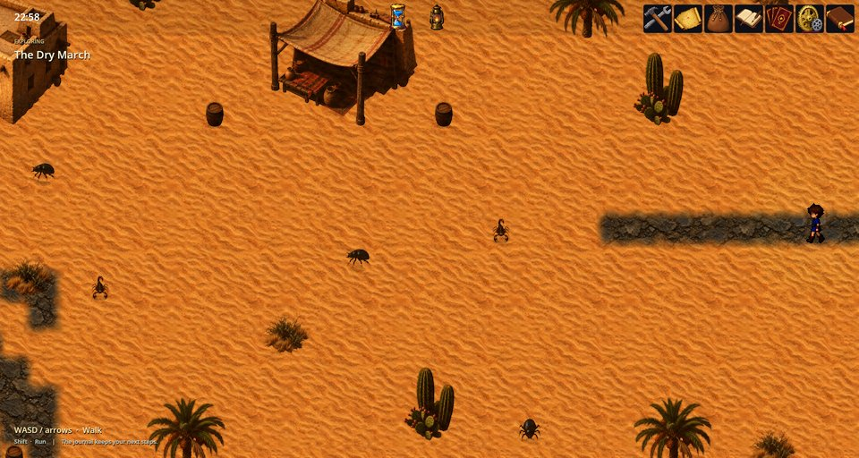
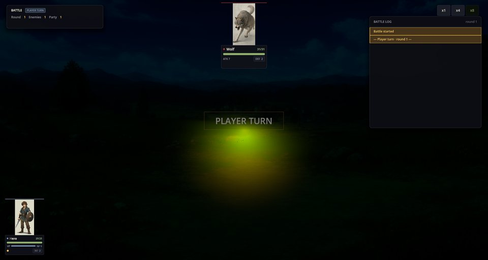

# RPG Plus — un RPG de bosque construido con mods

RPG Plus es un RPG pequeño y completo: un prólogo tipo novela visual donde eliges quién era tu héroe, después una aldea y un bosque sobre mapa de tiles, un misterio sobre la luz perdida del bosque, misiones secundarias, una mesa de trabajo, un mercader, un desierto al oeste y combates por turnos. El juego está hecho solo de archivos de datos y escenarios; sus reglas — atributos, equipo, pruebas, combates, crafteo — vienen de mods separados que cualquier otro juego también puede usar.

Se juega desde **Jugar → RPG Plus → Nueva partida**.


## La historia y cómo jugar

1. **El cruce de caminos.** Elige tu pasado: **soldado** (guerrero), **aprendiz de mago** (mago) o **vagabundo** (pícaro). La elección fija tus atributos y tu equipo inicial. Empiezas con 25 monedas.
2. **La aldea junto al Bosque Gris.** Camina con WASD o las flechas, corre con Shift, usa E o F para hablar e interactuar. El **diario** siempre anota tu siguiente paso concreto.
3. **El anciano** pregunta por la luz desaparecida o te manda directamente tras el lobo de la cueva del este.
4. **El bosque.** Recoge leña y setas; los limos sueltan resina viva y monedas. El lobo siempre suelta un corazón de ámbar y suficiente pelaje para un manto.
5. **La mesa de trabajo del pozo.** Prepara una pomada del bosque (seta + resina), un manto del guardián (2 pelajes + 2 resinas) o el farol guardián (ámbar + 2 resinas + 2 ramas). Ponte el manto desde la bolsa: cambia tus números reales de combate.
6. **La herborista**, junto a la valla occidental, necesita pomada; ayudarla lleva a un correo desaparecido en el bosque del sur.
7. **El santuario.** Lleva el farol por la cueva que está tras el lobo hasta el santuario en ruinas. Devuélvele la luz al bosque, o pacta por la aldea. Ambos finales cierran la aventura, y las últimas palabras del anciano siguen tu elección.

Otra gente de la aldea: el **instructor** te lleva al patio de entrenamiento (experiencia una vez, y una prueba de Fuerza para alzar un tronco), y la **adivina** lee tu suerte. El hogar junto al pozo restaura salud y maná. Las recompensas no se pueden cobrar dos veces.


### El desierto

Desde la aldea, sigue el camino principal hacia el oeste hasta salir del borde del mapa y llegarás a **la Marca Seca**: arena, una casa de adobe, un refugio de caravana, una torre en ruinas, palmeras y cactus. Cinco escorpiones y escarabajos esperan pelea, y los barriles de provisiones guardan pequeñas recompensas de una sola vez. El borde este devuelve a la aldea.



## Tu héroe

Abre la **hoja de personaje** desde la barra de herramientas para ver tu clase, nivel y experiencia, los atributos (Fuerza, Agilidad, Inteligencia, Vitalidad, Carisma, Suerte), los valores de combate y el equipo en las ranuras de arma, cuerpo y accesorio. Equípate desde la bolsa.


Los combates usan el estilo de órdenes (FF) con daño calculado por fórmulas. Algunas opciones de diálogo enfrentan un atributo a una tirada de d20, como el **[Fuerza 12]** del instructor.



## Cómo se monta el juego

RPG Plus es la colección **RPG Plus**. Sus bloques:

```text
Historia             rpg_plus_game (este mod)
Aldea y bosque       rpg_demo_game: los mapas, la gente y los objetos que este juego amplía
Recursos y reglas    village_pack (arte), classic_rpg_pack (atributos, clases, equipo)
Atributos y pruebas  stats_base, stat_checks
Mundo de tiles       rpg
Objetos, equipo, comercio  items_base, equipment, trading, crafting
Motor 2D             shell2d_base, dialog_base, characters_base, audio_base
Combate              turn_battle_base, ff_battle, battle_formulas
Combate de cartas    card_battle (opcional)
Interfaz             ui_base, menu_base
Editor de mapas de tiles  rpg_editor (opcional)
Editores de datos    schema_tools, items_editor, characters_editor (opcional)
Render de tiles      tile_topdown_base, tile_isometric_base
```

Ajustes de la colección: `battle.core` es `ff_battle`, las pruebas tiran `d20`, el sprite del héroe en el mapa es `village/hero`, los mapas se dibujan de arriba a abajo. Se cambian en **Mods & Collections → Colecciones → RPG Plus → Editar esquema**.

## Para autores: cámbialo sin código

```filestree
rpg_plus_game/
├── scenarios/rpg_plus/     prólogo, training_yard, events/ (instructor, adivina), woodland/, desert/
├── map_events/<map>/       gente nueva, la mesa de trabajo, la puerta de la cueva, barriles; los mismos id sustituyen a los de rpg_demo_game
├── maps/                   rpg_woodland_shrine.json, rpg_desert.json
├── scenes/                 cruce de caminos, patio de entrenamiento, santuario, desierto
├── quests/woodland.json    etapas del diario
├── items/, recipes/, stations/   materiales, objetos fabricados, el menú de la mesa de trabajo
├── patches/character.json  botín añadido a los monstruos de rpg_demo_game
├── patches/shop.json       más mercancías para el mercader de la aldea
└── characters/, charsets/, backgrounds/, locale/
```

**Amplía el mod de otro en vez de copiarlo.** La aldea, la casa y el bosque siguen viniendo de `rpg_demo_game`. Un evento con el mismo id que uno de allí lo sustituye (el anciano recibe diálogos nuevos); los id nuevos añaden gente. Los parches añaden botín a sus monstruos y mercancías a su tienda.

**Pruebas y condiciones en los escenarios.** La adivina prueba la Suerte y luego mira tu equipo:

```scenario
text "—¿Quieres saber qué te espera? Dame la mano. Esa no: la que no usas para robar." key=rpg_plus/seer/hello
check luk 14 who=rpg_hero else=fail -> :ok

:ok
text "—El lobo de la cueva teme más al fuego que al acero. Y golpea donde no tenga escudo. Esto es gratis. Lo demás, no." key=rpg_plus/seer/fortune
when "!equipped(rpg_hero, 'classic/clover_charm')" -> :charm
end
```

`when "item('rpg_plus/salve') >= 1"` mira la bolsa, `level(rpg_hero) >= 3` el nivel del héroe; las banderas hacen seguras las recompensas de una sola vez. Las líneas están escritas en ruso con un `key=` cada una; las traducciones están en `locale/scenarios_<lang>.properties`.

**Una receta** son datos en `recipes/woodland.json`:

```json
{
  "Id": "rpg_plus/salve",
  "Name": "rpg_plus/recipe/salve/name",
  "Type": "Cooking",
  "Input": [
    { "Id": "rpg_demo/mushroom", "Count": 1 },
    { "Id": "rpg_plus/resin", "Count": 1 }
  ],
  "Output": [{ "Id": "rpg_plus/salve", "Count": 1 }]
}
```

El **editor de mapas de tiles** opcional pinta suelo, colisiones y eventos, y el **Editor de datos** edita objetos, recetas y personajes. Actívalos en el esquema del juego.

## Si algo falla

1. **Falta el ámbar del lobo en una partida guardada antigua.** Ve al punto del lobo junto a la cueva y pulsa E/F: el ámbar se puede recoger allí una vez si no tienes ni él ni el farol.
2. **No sabes qué hacer ahora.** Abre el diario.
3. **Falta una opción de diálogo.** Algunas opciones aparecen solo tras una etapa de misión o con cierto objeto.
