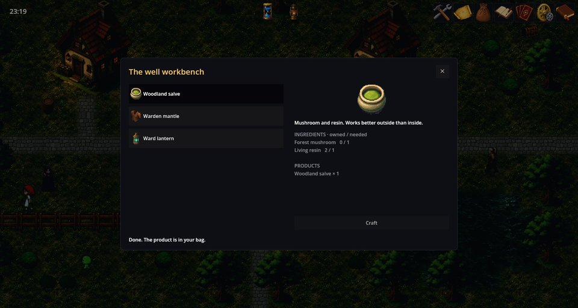

# RPG Plus — MOD で組み上げた森の RPG

RPG Plus は完成された小規模 RPG です。まず自分のヒーローの過去を選ぶビジュアルノベル形式のプロローグ、続いてタイルマップの村と森、森から消えた光の謎、サブクエスト、作業台、商人、西の砂漠、そしてターン制バトル。ゲームはデータファイルとシナリオだけでできており、ルール — ステータス、装備、判定、戦闘、クラフト — は別々の MOD が担います。どの MOD も他のゲームでも使えます。

開始は **プレイ → RPG Plus → ニューゲーム** から。


## 物語と遊び方

1. **岐路。** 過去を選びます:**兵士**(ウォリアー)、**魔法使いの弟子**(メイジ)、**流浪人**(ローグ)。選択がステータスと初期装備を決めます。所持金は 25 硬貨から。
2. **灰色の森のそばの村。** WASD か矢印キーで歩き、Shift で走り、E か F で話しかけ・調べます。**ジャーナル**は常に、次の具体的な一歩を示してくれます。
3. **村長**は消えた光について尋ねてくるか、東の洞窟の狼のもとへすぐに送り出します。
4. **森。** 柴とキノコを集めます。スライムは生きた樹脂と硬貨を落とします。狼は必ず琥珀の心臓と、マント一枚ぶんの毛皮を落とします。
5. **井戸の作業台。** 森の軟膏(キノコ + 樹脂)、森の番人のマント(毛皮 2 + 樹脂 2)、護りの灯籠(琥珀 + 樹脂 2 + 柴 2)を作れます。マントはインベントリから装備します。実際の戦闘の数値が変わります。
6. 西の柵のそばの**薬草師**は軟膏を求めています。手伝うと、南の森で行方不明になった伝令へとつながります。
7. **祠。** 灯籠を持って、狼の奥の洞窟を抜け、荒れた祠へ。光を森に返すか、村のために契りを交わすか。どちらの結末でも冒険は終わり、村長の最期の言葉はあなたの選択に従います。

村のその他の人々:**師匠**は稽古場へ連れて行ってくれ(経験値は一度、丸太を持ち上げる力の判定つき)、**占い師**はあなたの運を読みます。井戸のそばの囲み炉は体力とマナを回復します。報酬は二度は受け取れません。




### 砂漠

村から大通りを西へ、マップの端を出ていくと**乾いた辺境**に着きます。砂、日干しレンガの家、隊商の休憩小屋、崩れた塔、ヤシとサボテン。サソリと甲虫が五匹戦いを待ち、補給の樽には小さな一度きりの報酬が入っています。東の端から村へ戻れます。


## あなたのヒーロー

ツールバーから**キャラクターシート**を開くと、クラス、レベルと経験値、属性(力、敏捷、知力、体力、カリスマ、幸運)、戦闘値、武器・体・装飾品のスロットの装備が見られます。装備はインベントリから着けます。


戦闘はコマンド式(FF)バトルで、ダメージは数式で計算されます。会話の選択肢の一部は属性を d20 ロールで判定します。師匠の **[力 12]** がその例です。


## ゲームの構成

RPG Plus の正体はコレクション **RPG Plus** です。そのブロック:

```text
物語                 rpg_plus_game(この MOD)
村と森               rpg_demo_game:このゲームが拡張するマップ、人、アイテム
素材とルール         village_pack(アート)、classic_rpg_pack(ステータス、クラス、装備)
ステータスと判定     stats_base, stat_checks
タイル世界           rpg
アイテム、装備、交易 items_base, equipment, trading, crafting
2D エンジン          shell2d_base, dialog_base, characters_base, audio_base
戦闘                 turn_battle_base, ff_battle, battle_formulas
カードバトル         card_battle(任意)
インターフェース     ui_base, menu_base
タイルマップエディター  rpg_editor(任意)
データエディター     schema_tools, items_editor, characters_editor(任意)
タイルレンダラー     tile_topdown_base, tile_isometric_base
```

コレクションの設定:`battle.core` は `ff_battle`、判定は `d20` をロール、ヒーローのマップスプライトは `village/hero`、マップはトップダウン描画。**Mods & Collections → コレクション → RPG Plus → 構成を編集** から変えられます。

## 作者向け:コードなしで変える

```filestree
rpg_plus_game/
├── scenarios/rpg_plus/     プロローグ、training_yard、events/(師匠、占い師)、woodland/、desert/
├── map_events/<map>/       新しい人々、作業台、洞窟の扉、樽。同じ id は rpg_demo_game のものを置き換える
├── maps/                   rpg_woodland_shrine.json、rpg_desert.json
├── scenes/                 岐路、稽古場、祠、砂漠
├── quests/woodland.json    ジャーナルの段階
├── items/, recipes/, stations/   素材、作成品、作業台のメニュー
├── patches/character.json  rpg_demo_game のモンスターに追加されたドロップ
├── patches/shop.json       村の商人の商品の追加
└── characters/, charsets/, backgrounds/, locale/
```

**コピーせず、他の MOD を拡張する。** 村も家も森も今も `rpg_demo_game` から来ます。そこと同じ id のイベントはそれを置き換え(村長は新しい会話を得る)、新しい id は人を増やします。パッチはモンスターのドロップと店の商品を足します。

**シナリオの判定と条件。** 占い師は幸運を試し、それからあなたの装備を見ます:

```scenario
text "「この先を知りたいかい?手をお出し。そっちじゃない——盗みに使わないほうの手だよ」" key=rpg_plus/seer/hello
check luk 14 who=rpg_hero else=fail -> :ok

:ok
text "「洞窟の狼は鋼より火を恐れる。それと盾のないところを打ちな。ここまでは無料。残りは有料だよ」" key=rpg_plus/seer/fortune
when "!equipped(rpg_hero, 'classic/clover_charm')" -> :charm
end
```

`when "item('rpg_plus/salve') >= 1"` はインベントリを、`level(rpg_hero) >= 3` はヒーローのレベルを見ます。フラグのおかげで、一度きりの報酬は安全です。台詞はロシア語で書かれ、各行に `key=` が付きます。翻訳は `locale/scenarios_<lang>.properties` にあります。

**レシピ**は `recipes/woodland.json` のデータです:

```json
{
  "Id": "rpg_plus/salve",
  "Name": "rpg_plus/recipe/salve/name",
  "Type": "Cooking",
  "Input": [
    { "Id": "rpg_demo/mushroom", "Count": 1 },
    { "Id": "rpg_plus/resin", "Count": 1 }
  ],
  "Output": [{ "Id": "rpg_plus/salve", "Count": 1 }]
}
```

任意の**タイルマップエディター**は地面・衝突・イベントを描き、**データエディター**はアイテム・レシピ・キャラクターを編集します。ゲームの構成で有効にしてください。

## うまくいかないとき

1. **古いセーブに狼の琥珀がない。** 洞窟のそばの狼の場所へ行って E/F を押してください。琥珀も灯籠も持っていなければ、そこで一度だけ拾えます。
2. **次に何をすればいいか分からない。** ジャーナルを開きましょう。
3. **会話の選択肢が出ない。** 一部の選択肢は、特定のクエスト段階の後か、特定のアイテム所持時だけ現れます。
