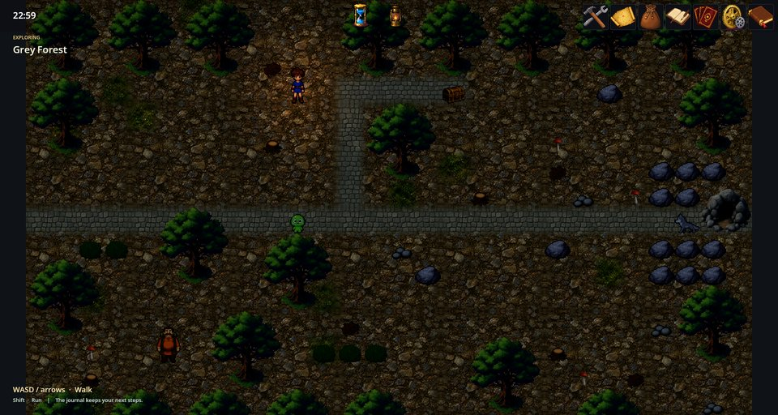
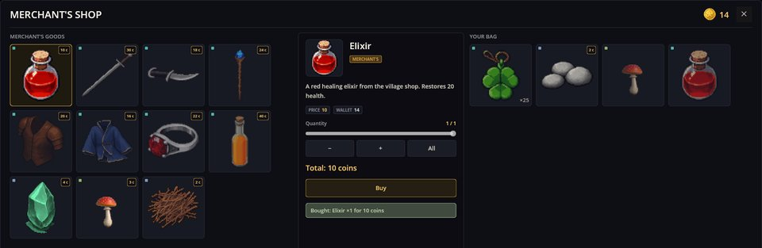
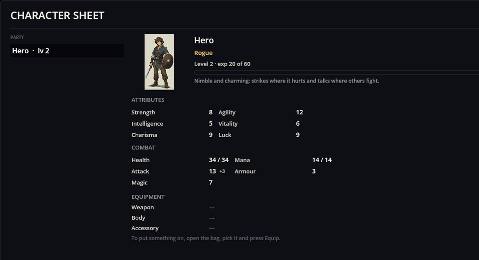

# RPG Plus — 모드로 지어 올린 숲의 RPG

RPG Plus는 완성된 소규모 RPG입니다. 영웅의 과거를 고르는 비주얼 노벨 프롤로그, 이어서 타일맵의 마을과 숲, 숲에서 사라진 빛의 미스터리, 사이드 퀘스트, 작업대, 상인, 서쪽의 사막, 그리고 턴제 전투. 게임은 데이터 파일과 시나리오만으로 이루어져 있고, 규칙 — 스탯, 장비, 판정, 전투, 제작 — 은 별개의 모드가 담당합니다. 어떤 모드든 다른 게임에서도 쓸 수 있습니다.

**플레이 → RPG Plus → 새 게임**에서 시작합니다.


## 이야기와 진행 방법

1. **갈림길.** 과거를 고르세요: **군인**(전사), **마법사 견습생**(메이지), **방랑자**(로그). 선택이 스탯과 시작 장비를 정합니다. 시작 자금은 동전 25닢.
2. **잿빛 숲 옆 마을.** WASD나 방향키로 걷고, Shift로 뛰고, E나 F로 말하고 상호작용합니다. **저널**은 언제나 다음 구체적 한 걸음을 알려 줍니다.
3. **촌장**은 사라진 빛을 묻거나, 곧장 동쪽 동굴의 늑대에게 보냅니다.
4. **숲.** 땔감과 버섯을 모으세요. 슬라임은 산 수지와 동전을 남깁니다. 늑대는 언제나 호박 심장과 망토 한 벌分의 털을 남깁니다.
5. **우물 작업대.** 숲 연고(버섯 + 수지), 숲 수호자 망토(털 2 + 수지 2), 수호 등불(호박 + 수지 2 + 땔감 2)을 만들 수 있습니다. 망토는 가방에서 착용하세요. 실제 전투 수치가 바뀝니다.
6. 서쪽 울타리 옆 **약초상**은 연고가 필요합니다. 돕다 보면 남쪽 숲에서 실종된 전령으로 이어집니다.
7. **성소.** 등불을 들고 늑대 너머의 동굴을 지나 폐허가 된 성소로 가세요. 숲에 빛을 돌려주거나, 마을을 위해 계약을 맺거나. 두 결말 모두 모험을 끝내고, 촌장의 마지막 말은 당신의 선택을 따릅니다.

마을의 다른 사람들: **훈련관**은 수련장으로 안내해 주고(경험치는 한 번, 통나무 드는 힘 판정 포함), **점쟁이**는 당신의 행운을 읽습니다. 우물 곁 화덕은 체력과 마나를 회복합니다. 보상은 두 번 받을 수 없습니다.







### 사막

마을에서 큰길을 따라 서쪽으로, 맵 끝을 벗어나면 **마른 변경**에 닿습니다. 모래, 흙벽돌 집, 상로막 쉼터, 무너진 탑, 야자수와 선인장. 전갈과 딱정벌레 다섯 마리가 싸움을 기다리고, 보급 통에는 작은 일회성 보상이 들어 있습니다. 동쪽 끝은 다시 마을로 돌아갑니다.


## 당신의 영웅

툴바에서 **캐릭터 시트**를 열면 클래스, 레벨과 경험치, 속성(힘, 민첩, 지능, 생명력, 매력, 행운), 전투 수치, 그리고 무기·몸·장신구 슬롯의 장비를 볼 수 있습니다. 장비는 가방에서 착용합니다.



전투는 커맨드식(FF) 전투로, 피해는 공식으로 계산됩니다. 일부 대화 선택지는 속성을 d20 굴림으로 판정합니다. 훈련관의 **[힘 12]**가 그 예입니다.


## 게임의 구성

RPG Plus의 정체는 컬렉션 **RPG Plus**입니다. 그 블록:

```text
이야기와 세계    rpg_plus_game
에셋과 규칙          village_pack(그림), classic_rpg_pack(스탯, 클래스, 장비)
스탯과 판정          stats_base, stat_checks
타일 세계            rpg
아이템, 장비, 거래   items_base, equipment, trading, crafting
2D 엔진              shell2d_base, dialog_base, characters_base, audio_base
전투                 turn_battle_base, ff_battle, battle_formulas
카드 배틀            card_battle(선택)
인터페이스           ui_base, menu_base
타일맵 편집기        rpg_editor(선택)
데이터 편집기        schema_tools, items_editor, characters_editor(선택)
타일 렌더러          tile_topdown_base, tile_isometric_base
```

컬렉션 설정: `battle.core`는 `ff_battle`, 판정은 `d20`을 굴리고, 영웅의 맵 스프라이트는 `village/hero`, 맵은 탑다운으로 그려집니다. **Mods & Collections → 컬렉션 → RPG Plus → 구성 편집**에서 바꿀 수 있습니다.

## 모드 작성자를 위해: 코드 없이 바꾸기

```filestree
rpg_plus_game/
├── maps/                       village, house, forest, shrine, desert
├── scenes/                     tile maps, crossroads, training yard
├── placements/<map>/           NPCs, doors, pickups, barrels
├── scenarios/rpg_plus/         village intro, map interactions, prologue, training, woodland, desert
├── characters/                 hero, monsters, stats and loot
├── shops/village_merchant.json
├── items/, recipes/, stations/
├── quests/woodland.json
└── charsets/, backgrounds/, locale/
```

맵, 이벤트, 캐릭터, 아이템, 상점과 이야기는 모두 `rpg_plus_game`에 있습니다. 몬스터 능력치와 전리품은 `characters/rpg_plus_characters.json`, 상인은 `shops/village_merchant.json`에서 직접 편집합니다. 저장 호환성을 위해 `rpg_plus/` 리소스 키를 유지하며 별도 모드는 아닙니다.

**시나리오의 판정과 조건.** 점쟁이는 행운을 시험한 뒤 당신의 장비를 봅니다:

```scenario
text "“무엇이 기다리는지 알고 싶어? 손을 줘. 그거 말고 — 도둑질 안 하는 손.”" key=rpg_plus/seer/hello
check luk 14 who=rpg_hero else=fail -> :ok

:ok
text "“동굴의 늑대는 강철보다 불을 더 무서워해. 그리고 보호막이 없는 데를 쳐. 여기까진 공짜야. 나머진 아니고.”" key=rpg_plus/seer/fortune
when "!equipped(rpg_hero, 'classic/clover_charm')" -> :charm
end
```

`when "item('rpg_plus/salve') >= 1"`은 가방을, `level(rpg_hero) >= 3`은 영웅의 레벨을 봅니다. 플래그 덕분에 일회성 보상은 안전합니다. 대사는 러시아어로 쓰였고 각 줄에 `key=`가 있습니다. 번역은 `locale/scenarios_<lang>.properties`에 있습니다.

**레시피**는 `recipes/woodland.json`의 데이터입니다:

```json
{
  "Id": "rpg_plus/salve",
  "Type": "Cooking",
  "Input": [
    { "Id": "rpg_plus/mushroom", "Count": 1 },
    { "Id": "rpg_plus/resin", "Count": 1 }
  ],
  "Output": [{ "Id": "rpg_plus/salve", "Count": 1 }]
}
```

선택인 **타일맵 편집기**는 지면·충돌·이벤트를 그리고, **데이터 편집기**는 아이템·레시피·캐릭터를 편집합니다. 게임의 구성에서 켜세요.

## 문제가 생겼을 때

1. **오래된 저장 파일에 늑대의 호박이 없습니다.** 동굴 옆 늑대 자리로 가서 E/F를 누르세요. 호박과 등불이 둘 다 없다면 그곳에서 한 번 주울 수 있습니다.
2. **다음에 뭘 해야 할지 모르겠습니다.** 저널을 여세요.
3. **대화 선택지가 사라졌습니다.** 어떤 선택지는 특정 퀘스트 단계 후에, 또는 특정 아이템이 있을 때만 나타납니다.
