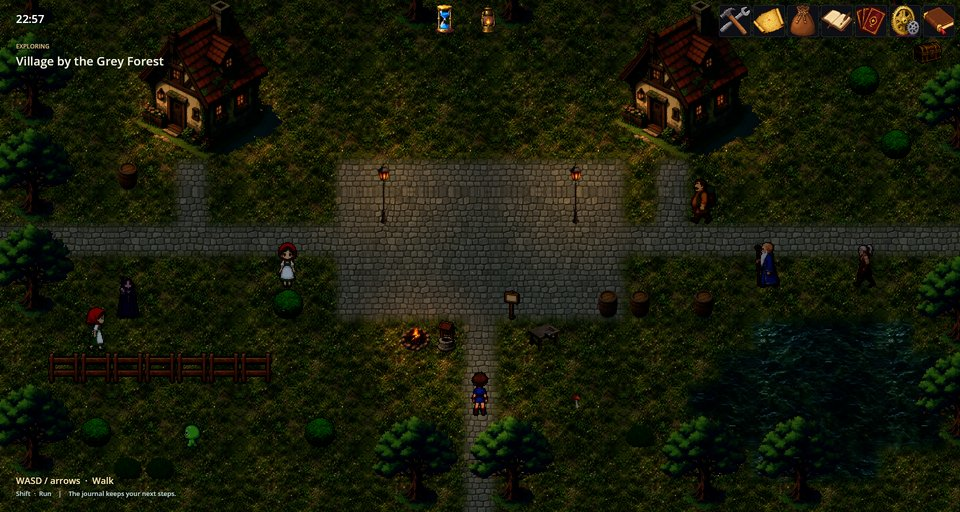
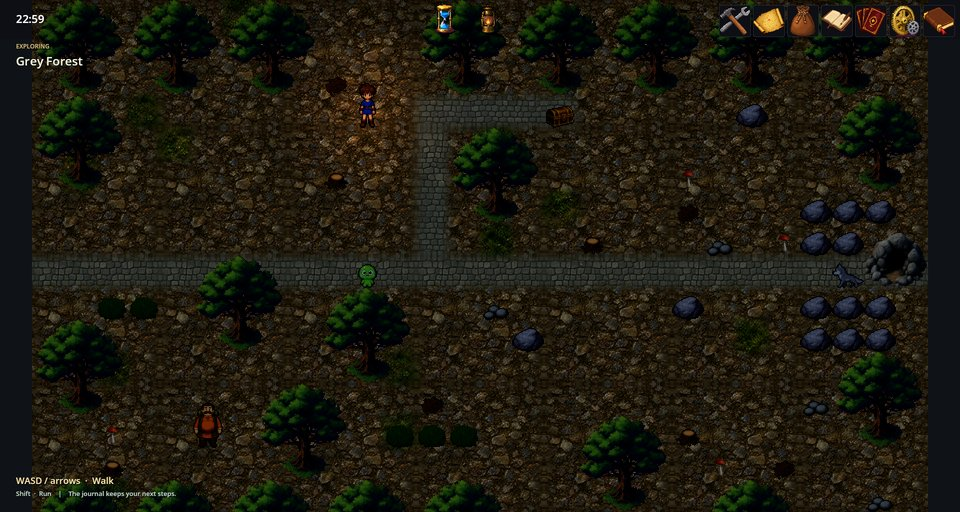
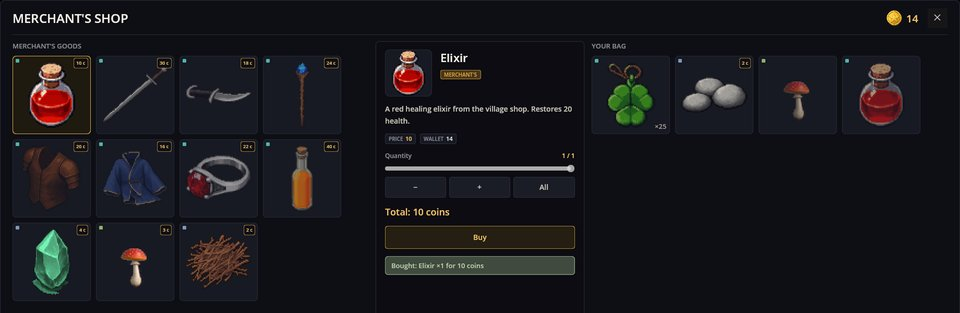

# RPG Plus — лесная RPG, собранная из модов

RPG Plus — законченная небольшая RPG: пролог-новелла, где вы выбираете, кем был ваш герой, затем деревня и лес на тайловой карте, тайна пропавшего лесного света, побочные задания, верстак, торговец, пустыня на западе и пошаговые бои. Игра состоит только из файлов данных и сценариев; правила — характеристики, снаряжение, проверки, бои, крафт — приносят отдельные моды, которые может взять и любая другая игра.

Запуск — **Играть → RPG Plus → Новая игра**.

Хотите сделать свою игру? Пройдите **Первая игра за 10 минут** в документации **RPG Map Editor** (мод `rpg_editor`): это путь мышью от нового мода до своей карты, сундука, диалога и спутницы.


## История и как играть

1. **Перекрёсток.** Выберите своё прошлое: **солдат** (воин), **ученик мага** (маг) или **странник** (плут). Выбор задаёт характеристики и стартовое снаряжение. На старте у вас 25 монет.
2. **Деревня у Серого леса.** Ходите на WASD или стрелки, бегите на Shift, говорите и взаимодействуйте на E или F. **Журнал** всегда называет ваш конкретный следующий шаг.
3. **Староста** спрашивает о пропавшем свете или сразу отправляет вас за волком у восточной пещеры.
4. **Лес.** Собирайте хворост и грибы; слизни оставляют живую смолу и монеты. Волк всегда оставляет сердце янтаря и столько шерсти, что хватит на плащ.
5. **Верстак у колодца.** Сварите лесную мазь (гриб + смола), сшейте плащ лесного стража (2 шерсти + 2 смолы) или соберите сторожевой фонарь (янтарь + 2 смолы + 2 веток). Плащ надевается из сумки: он меняет ваши настоящие боевые числа.
6. **Травница** у западного забора просит мазь; помощь ей приводит к пропавшему курьеру в южном лесу.
7. **Святилище.** Пронесите фонарь через пещеру за волком к разрушенному святилищу. Верните лесу свет — или заключите сделку ради деревни. Обе концовки завершают приключение, а последние слова старосты зависят от вашего выбора.

Прочие жители деревни: **наставник** ведёт на тренировочную площадку (опыт один раз и проверка силы с бревном), **гадалка** читает вашу удачу. Очаг у колодца восстанавливает здоровье и ману. Награды нельзя собрать дважды.








### Пустыня

От деревни пройдите по главной дороге на запад, за край карты, — попадёте в **Сухой предел**: песок, глинобитный дом, навес каравана, разрушенная башня, пальмы и кактусы. Пять скорпионов и жуков ждут боя, а бочки припасов хранят небольшие разовые награды. Восточный край ведёт обратно к деревне.


## Ваш герой

Откройте **лист персонажа** с панели инструментов: класс, уровень и опыт, характеристики (Сила, Ловкость, Интеллект, Выносливость, Харизма, Удача), боевые значения и снаряжение в слотах оружия, брони и аксессуара. Надевайте вещи из сумки.


Бои идут в командном стиле (FF), урон считается по формулам. Часть вариантов диалога проверяет характеристику броском d20 — например, **[Сила 12]** у наставника.


## Как игра собрана

RPG Plus — это коллекция **RPG Plus**. Её блоки:

```text
Сюжет и мир    rpg_plus_game
Ресурсы и правила     village_pack (арт), classic_rpg_pack (характеристики, классы, снаряжение)
Характеристики и проверки  stats_base, stat_checks
Тайловый мир          rpg
Предметы, снаряжение, торговля  items_base, equipment, trading, crafting
2D-движок             shell2d_base, dialog_base, characters_base, audio_base
Бой                   turn_battle_base, ff_battle, battle_formulas
Карточный бой         card_battle (опционально)
Интерфейс             ui_base, menu_base
Редактор тайловых карт  rpg_editor (опционально)
Редакторы данных      schema_tools, items_editor, characters_editor (опционально)
Тайловый рендер       tile_topdown_base, tile_isometric_base
```

Настройки коллекции: `battle.core=ff_battle`, `checks.dice=d20`, `stats.player=rpg_hero`, `tile.renderer=topdown`. Они меняются в схеме игры. Лист ходьбы `village/hero` задаёт `Charset` персонажа-героя; меняйте его в редакторе персонажей.

## Авторам: меняйте без кода

```filestree
rpg_plus_game/
├── maps/                       village, house, forest, shrine, desert
├── scenes/                     tile maps, crossroads, training yard
├── placements/<map>/           NPCs, doors, pickups, barrels
├── scenarios/rpg_plus/         village intro, map interactions, prologue, training, woodland, desert
├── characters/                 hero, monsters, stats and loot
├── shops/village_merchant.json
├── items/, recipes/, stations/
├── quests/woodland.json
└── charsets/, backgrounds/, locale/
```

Весь игровой контент находится в `rpg_plus_game`: карты, события, персонажи, предметы, магазины и сюжет. Характеристики и добыча монстров задаются в `characters/rpg_plus_characters.json`, торговец — в `shops/village_merchant.json`. Ключи ресурсов `rpg_plus/` сохранены для совместимости сохранений; отдельного мода demo больше нет.

**Проверки и условия в сценариях.** Гадалка испытывает Удачу, а потом смотрит на ваше снаряжение:

```scenario
text "— Хочешь знать, что тебя ждёт? Дай руку. Не эту — ту, которой не воруешь." key=rpg_plus/seer/hello
check luk 14 who=rpg_hero else=fail -> :ok

:ok
text "— Волк у пещеры боится огня больше, чем стали. И бей туда, где у него нет щита. Это бесплатно. Остальное — нет." key=rpg_plus/seer/fortune
when "!equipped(rpg_hero, 'classic/clover_charm')" -> :charm
end
```

`when "item('rpg_plus/salve') >= 1"` заглядывает в сумку, `level(rpg_hero) >= 3` — в уровень героя; флаги делают разовые награды безопасными. Строки написаны по-русски, у каждой есть `key=`; переводы лежат в `locale/scenarios_<lang>.properties`.

**Рецепт** — это данные в `recipes/woodland.json`:

```json
{
  "Id": "rpg_plus/salve",
  "Type": "Cooking",
  "Input": [
    { "Id": "rpg_plus/mushroom", "Count": 1 },
    { "Id": "rpg_plus/resin", "Count": 1 }
  ],
  "Output": [{ "Id": "rpg_plus/salve", "Count": 1 }]
}
```

Опциональный **редактор тайловых карт** рисует землю, коллизии и события, а **редактор данных** правит предметы, рецепты и персонажей. Включите их в схеме игры.

## Если что-то пошло не так

1. **В старом сохранении нет янтаря волка.** Подойдите к месту волка у пещеры и нажмите E/F: янтарь можно подобрать там один раз, если у вас нет ни его, ни фонаря.
2. **Неясно, что делать дальше.** Откройте журнал.
3. **Пропал вариант диалога.** Некоторые варианты появляются только после определённого этапа задания или при нужном предмете.
