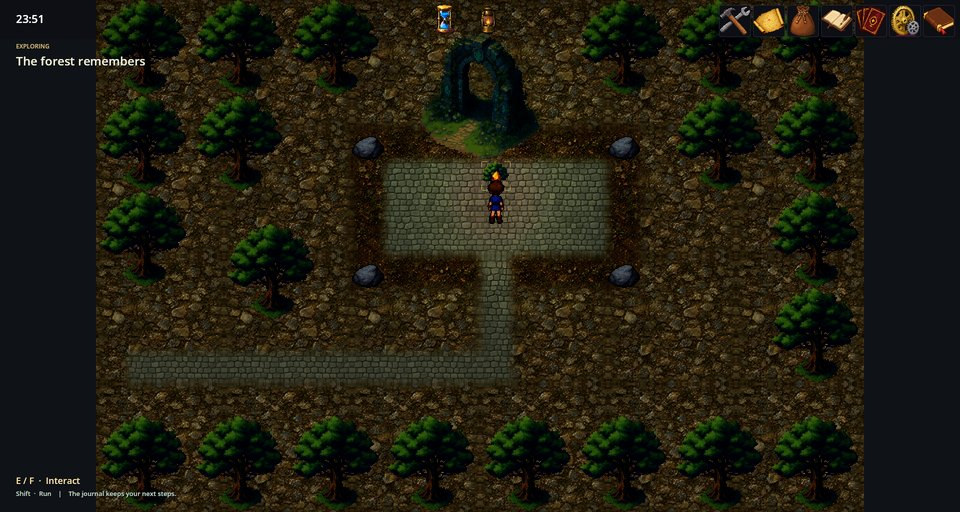

# RPG Plus — 用模组搭起来的森林 RPG

RPG Plus 是一款完整的小型 RPG：先是一段视觉小说序章，让你选择英雄的过去；然后是图块地图上的村庄与森林、关于森林失落的神秘之光的主线、支线任务、工作台、商人、西边的沙漠和回合制战斗。游戏只由数据文件和剧本组成；规则——属性、装备、检定、战斗、制作——则来自独立的模组，任何其他游戏同样可以复用。

从“开始游戏 → RPG Plus → 新游戏”进入。


## 剧情与玩法

1. **岔路口。** 选择你的过去：**士兵**（战士）、**魔法师学徒**（法师）或**流浪者**（盗贼）。选择决定你的属性和初始装备。开局有 25 枚硬币。
2. **灰森林旁的村庄。** 用 WASD 或方向键行走，Shift 奔跑，E 或 F 交谈与互动。**日志**始终列着你接下来该做的具体一步。
3. **村长**会问起失踪的光，或者直接派你去东边洞穴对付那只狼。
4. **森林。** 采集柴火和蘑菇；史莱姆掉落活树脂和硬币。狼必定掉落琥珀之心，以及足够做一件斗篷的毛皮。
5. **井边工作台。** 制作林间药膏（蘑菇 + 树脂）、守林人斗篷（2 毛皮 + 2 树脂）或守护提灯（琥珀 + 2 树脂 + 2 柴火）。斗篷可以从背包直接穿上：它会改变你真实的战斗数值。
6. 西边栅栏旁的**草药师**需要药膏；帮她之后，会引出南方森林里失踪的信使。
7. **圣祠。** 带着提灯穿过狼身后的洞穴，抵达荒废的圣祠。把光还给森林，或者为村庄立下一纸契约。两个结局都会完结这段冒险，村长最后的嘱托也随你的选择而变。

村里还有别人：**教头**会带你去练武场（经验只有一次，还有一次举起原木的力量检定），**占卜师**为你解读运气。井边的炉火恢复生命和法力。奖励不能重复领取。




### 沙漠

从村庄沿主路向西走出地图边缘，就到了**枯荒之地**：黄沙、一座土坯房、一处商队棚屋、一座残塔、棕榈和仙人掌。五只蝎子和甲虫等着开打，补给桶里装着小份的一次性奖励。东边边缘通回村庄。


## 你的英雄

从工具栏打开**角色面板**，可以看到职业、等级和经验、属性（力量、敏捷、智力、体质、魅力、幸运）、战斗数值，以及武器、身体、饰品三个栏位里的装备。装备从背包里穿上。


战斗采用指令式（FF），伤害由公式计算。部分对话选项会让属性对抗一次 d20 掷骰，比如教头的**[力量 12]**。


## 游戏的组成

RPG Plus 就是合集 **RPG Plus**。它的分组：

```text
剧情                 rpg_plus_game（本模组）
村庄与森林           rpg_demo_game：本游戏在其上扩展的地图、人物和物品
素材与规则           village_pack（美术）、classic_rpg_pack（属性、职业、装备）
属性与检定           stats_base, stat_checks
图块世界             rpg
物品、装备、交易     items_base, equipment, trading, crafting
2D 引擎              shell2d_base, dialog_base, characters_base, audio_base
战斗                 turn_battle_base, ff_battle, battle_formulas
卡牌战斗             card_battle（可选）
界面                 ui_base, menu_base
图块地图编辑器       rpg_editor（可选）
数据编辑器           schema_tools, items_editor, characters_editor（可选）
图块渲染器           tile_topdown_base, tile_isometric_base
```

合集的设置：`battle.core` 为 `ff_battle`，检定掷 `d20`，英雄的地图贴图为 `village/hero`，地图以俯视方式绘制。可在 **Mods & Collections → 合集 → RPG Plus → 编辑结构** 中修改。

## 给模组作者：不改代码就能改内容

```filestree
rpg_plus_game/
├── scenarios/rpg_plus/     序章、training_yard、events/（教头、占卜师）、woodland/、desert/
├── map_events/<map>/       新人物、工作台、洞穴门、木桶；相同 id 的事件会覆盖 rpg_demo_game 的
├── maps/                   rpg_woodland_shrine.json, rpg_desert.json
├── scenes/                 岔路口、练武场、圣祠、沙漠
├── quests/woodland.json    日志的阶段
├── items/, recipes/, stations/   材料、成品、工作台的菜单
├── patches/character.json  给 rpg_demo_game 的怪物追加的掉落
├── patches/shop.json       给村庄商人追加的商品
└── characters/, charsets/, backgrounds/, locale/
```

**去扩展别的模组，而不是复制它。** 村庄、房屋和森林仍然来自 `rpg_demo_game`。与那里相同 id 的事件会将其替换（村长得到新对话）；新 id 则添加人物。补丁给它的怪物添加掉落，给它的商店添加商品。

**剧本中的检定与条件。** 占卜师先测试幸运，再打量你的装备：

```scenario
text "“想知道等着你的是什么？把手给我。不是这只——是你不用来偷东西的那只。”" key=rpg_plus/seer/hello
check luk 14 who=rpg_hero else=fail -> :ok

:ok
text "“洞口的狼怕火胜过怕钢。还有，往它没护盾的地方打。这些免费。其余的不免费。”" key=rpg_plus/seer/fortune
when "!equipped(rpg_hero, 'classic/clover_charm')" -> :charm
end
```

`when "item('rpg_plus/salve') >= 1"` 检查背包，`level(rpg_hero) >= 3` 检查英雄的等级；标志位让一次性奖励不会重复。台词以俄语写成，每行带一个 `key=`；翻译在 `locale/scenarios_<lang>.properties` 里。

**配方**就是 `recipes/woodland.json` 里的数据：

```json
{
  "Id": "rpg_plus/salve",
  "Name": "rpg_plus/recipe/salve/name",
  "Type": "Cooking",
  "Input": [
    { "Id": "rpg_demo/mushroom", "Count": 1 },
    { "Id": "rpg_plus/resin", "Count": 1 }
  ],
  "Output": [{ "Id": "rpg_plus/salve", "Count": 1 }]
}
```

可选的**图块地图编辑器**负责绘制地面、碰撞和事件，**数据编辑器**则编辑物品、配方和角色。在游戏的结构里打开它们。

## 出问题了怎么办

1. **旧存档里没有狼的琥珀。** 走到洞穴旁狼所在的位置按 E/F：只要你既没有琥珀也没有提灯，就能在那里捡到一次。
2. **不知道下一步做什么。** 打开日志。
3. **某个对话选项不见了。** 有些选项只有推进到某个任务阶段或持有特定物品后才会出现。
